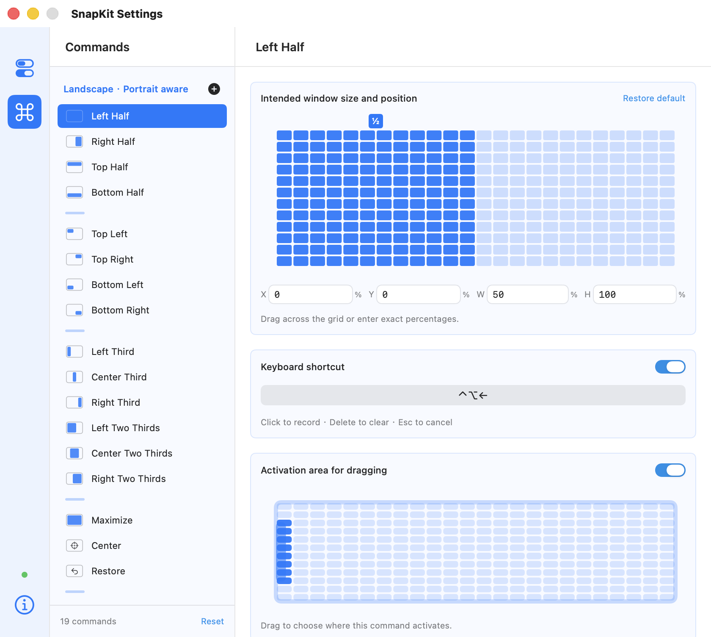
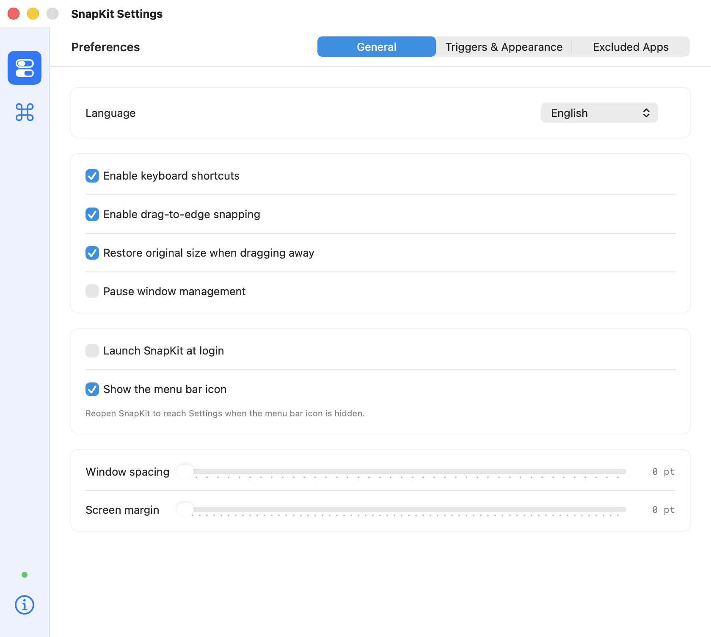

# SnapKit

[简体中文](README.zh-CN.md)

A lightweight native macOS window manager. Arrange windows with keyboard shortcuts, edge snapping and editable layouts. Built with Swift, AppKit and SwiftUI, with no third-party app dependencies.

[Download for Apple Silicon](https://github.com/luchuangao/SnapKit/releases/latest) · [Report an issue](https://github.com/luchuangao/SnapKit/issues)

## Features

- 19 built-in commands: halves, quarters, thirds, two-thirds, maximize, center, restore and adjacent displays.
- Global keyboard shortcuts with recording, duplicate detection and registration-error feedback.
- Drag-to-edge snapping with target previews, configurable activation areas and an Option-key bypass.
- Editable 24 × 12 layout grid, custom commands and percentage-based position/size controls.
- Local preferences for spacing, margins, preview appearance, excluded apps and login launch.
- Chinese and English interfaces, selectable in Settings → General → Language.
- Optional experimental green-window-button menu.

## Screenshots

Actual English app windows, exported from the running application. Chinese captures are included separately under [Docs/Screenshots](Docs/Screenshots).




## Installation

The current downloadable build is **v1.1.2 for Apple Silicon, macOS 13+**.

1. Download the DMG from [Releases](https://github.com/luchuangao/SnapKit/releases/latest).
2. Open it and drag SnapKit to Applications.
3. Open SnapKit. The official release is **Developer ID signed and Apple-notarized**, with the notarization ticket attached to the app.
4. Enable SnapKit in System Settings → Privacy & Security → Accessibility so it can move other applications’ windows.

SnapKit runs in the menu bar. Reopen the app or press `⌘,` while Settings is active to reach its settings. No automatic updater is included. See [signing and notarization](Docs/Notarization.md) for verification and release instructions.

## Shortcuts

All basic commands use Control + Option. Shortcuts are editable.

| Command | Key |
| --- | --- |
| Left / right / top / bottom half | ← / → / ↑ / ↓ |
| Top left / top right / bottom left / bottom right | U / I / J / K |
| Left / center / right third | D / F / G |
| Left / center / right two-thirds | E / R / T |
| Maximize / center / restore | Return / C / Delete |
| Previous / next display | Control + Option + Command + ← / → |

## Build

Requires macOS 13+ and Xcode Command Line Tools. Current local builds use Swift 6.3.2 in Swift 5 language mode.

```sh
swift test
./Scripts/build.sh
open dist/SnapKit.app
```

Open `Package.swift` in Xcode to develop the app. `./Scripts/package.sh` creates versioned DMG, app ZIP and source ZIP files under `dist/`. Build on Intel hardware to produce an Intel build; the downloadable package is arm64 only.

## Verification and limits

Eight geometry tests cover odd-sized displays, margins/gutters, negative display origins, portrait thirds, trigger precedence, centering and proportional display transfers. A local AX integration run passed eight window transformations. See [validation notes](Research/validation.md) for the exact scope.

- The implementation is independently based on Magnet’s public feature descriptions and screenshots. It is not affiliated with Magnet or BOOTCODE, and does not contain Magnet code or claim complete behavioral equivalence.
- No iCloud sync is implemented.
- Apps may enforce minimum sizes or use nonstandard windows. Native full-screen windows and cross-Space moves are outside the supported scope.
- Multi-display and portrait calculations have unit coverage; actual multi-monitor hardware testing remains outstanding.
- Drag interactions, system hotkeys and the experimental green-button menu still need broader manual validation on supported macOS versions.
- Most compatibility shortcut defaults have not been verified against a running copy of Magnet.

Preferences are stored locally with UserDefaults. The app has no analytics or app network client. It reads window geometry via macOS Accessibility APIs to perform user-triggered window management.

Release packaging excludes local debug paths and untracked source files. See [public release privacy](Docs/ReleasePrivacy.md) for the checks and their limits.

## Reproducing interface captures

Quit other SnapKit instances, build the app, then run:

```sh
./Scripts/capture-screenshots.sh
```

This launches the real app in Chinese and English and exports its actual rendered window for each scene. It does not generate mock UI, alter screenshot text, or capture another application. Each PNG has companion metadata documenting language, scene, version and dimensions.

The approved app icon is in `Resources/AppIcon.png` and `Resources/AppIcon.icns`; `Scripts/build-icons.sh` exports all macOS icon sizes. Production design provenance is in [Branding/Final](Branding/Final).
